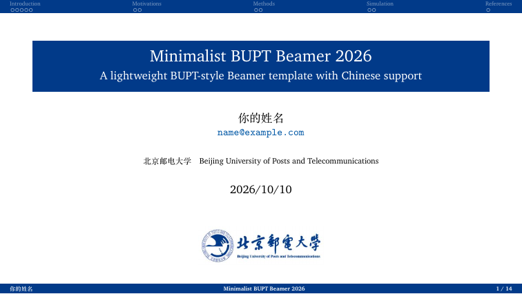
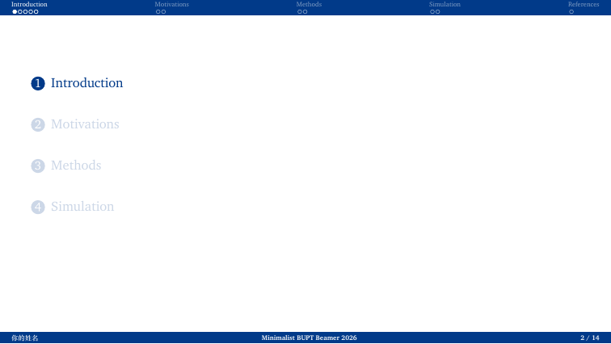
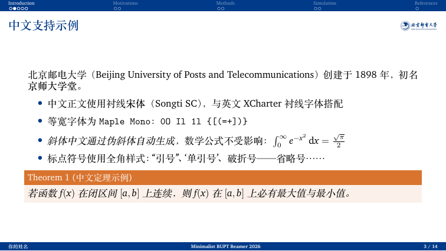
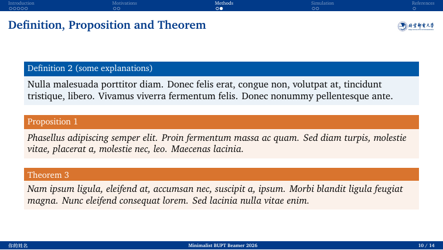
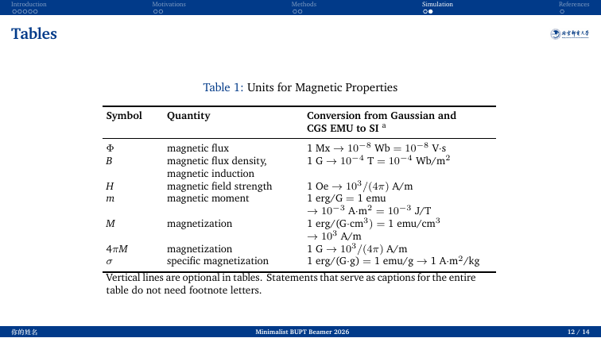
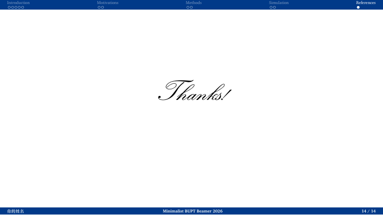

# Minimalist BUPT Beamer 2026

一个由 `minimalist-pku-beamer-2026` 改造而来的北京邮电大学 Beamer 模板，融合北邮视觉识别系统中的校徽、标准中英文校名组合图和深蓝色主色。

## 特点

- 16:9 宽屏布局，也支持 `aspectratio=43` 切换为 4:3。
- XeLaTeX 编译，支持中文、英文和中英文混排。
- 顶部导航条、正文标题栏、底部信息栏保持轻量、平面化的版式。
- 标题栏右上角和首页使用北邮校徽与中英文校名组合图。
- 正文区块、定理、引用和表格使用北邮深蓝体系。
- 主题主色为北邮 VI 素材中的深蓝 `#013A89`。

## 预览

以下图片来自仓库中 `main.tex` 的实际 XeLaTeX 编译结果，展示了首页、目录页、中文排版、定理区块和三线表格等页面。点击图片可以查看大图。

| 首页 | 目录页 | 中文正文 |
| --- | --- | --- |
| [](docs/preview-title.png) | [](docs/preview-toc.png) | [](docs/preview-chinese.png) |

| 定理与区块 | 三线表格 | 结束页 |
| --- | --- | --- |
| [](docs/preview-theorem.png) | [](docs/preview-table.png) | [](docs/preview-thanks.png) |

预览图由当前模板编译生成；修改 `main.tex` 后，可以使用 XeLaTeX 重新生成自己的 PDF 和预览。

完整编译结果： [下载 `main.pdf`](main.pdf)。

## 文件结构

```text
bupt-beamer/
├── BUPT.sty
├── main.tex
├── ref.bib
├── Figures/
│   ├── BUPT-emblem-names.jpg
│   └── fig1.png
└── clean.sh
```

## 编译

```bash
xelatex main.tex
```

也可以使用仓库附带的清理脚本：

```bash
./clean.sh
./clean.sh --deep
```

编辑 `main.tex` 中的 `\\title`、`\\author`、`\\institute` 和 `\\date`，把图片放入 `Figures/` 即可开始制作幻灯片。模板默认使用 16:9 宽屏：

```latex
\\documentclass[10pt,aspectratio=169]{beamer}
```

切换为 4:3：

```latex
\\documentclass[10pt,aspectratio=43]{beamer}
```

## 字体

正文中文默认优先使用 macOS 的 Songti SC，其他环境回退到 TeX Live 自带的 FandolSong。英文字体使用 XCharter；等宽字体优先使用 Maple Mono。

## 来源

- 版式结构和 Beamer 定制逻辑来自 [`rexera/minimalist-pku-beamer-2026`](https://github.com/rexera/minimalist-pku-beamer-2026)。
- 校徽与中英文校名组合图来自北邮 VI 源文件，并转换为模板所需的 JPG 资源。
- 北邮视觉形象的版权归北京邮电大学所有。
